# AI, Deep Learning, CV, NLP & Time Series: Complete Notes

IT Vedant course ke saare modules ke notes: definitions, diagrams, formulas, code aur interview points.

---

## 1. Understanding the World of AI

### 1.1 What is AI?

AI (Artificial Intelligence) = machines ko aisa banana ki wo human jaisi intelligence dikhayein: seekhna, reason karna, decision lena, language samajhna.

**Types of AI (capability ke basis par)**

| Type | Meaning | Example |
| --- | --- | --- |
| Narrow AI (ANI) | Ek specific kaam mein expert | Siri, Netflix recommendations, spam filter |
| General AI (AGI) | Insaan jaisa har kaam kar sake | Abhi exist nahi karta |
| Super AI (ASI) | Insaan se zyada smart | Sirf theory / sci-fi |

**Types of AI (functionality ke basis par):** Reactive Machines (Deep Blue chess), Limited Memory (self-driving cars), Theory of Mind (research stage), Self-Aware (hypothetical).

### 1.2 AI vs ML vs DL

<p align="center">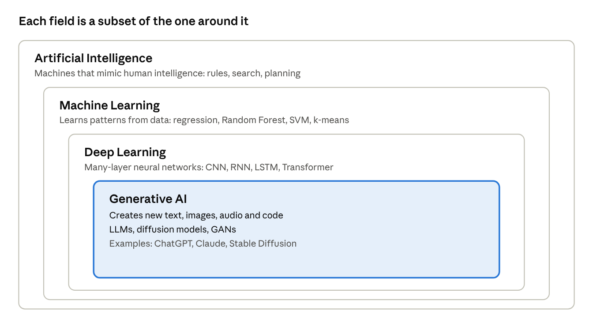<br><sub><i>AI, ML, DL and GenAI · nested diagram</i></sub></p>

| Point | AI | ML | DL |
| --- | --- | --- | --- |
| Scope | Sabse bada | AI ka subset | ML ka subset |
| Data need | Varies | Medium | Bahut zyada |
| Feature engineering | Manual rules | Manual | Automatic |
| Hardware | Normal | CPU ok | GPU/TPU chahiye |
| Example | Rule-based expert system | Random Forest, SVM | CNN, LSTM, Transformer |

**ML ke 3 types:** Supervised (labelled data: regression, classification), Unsupervised (unlabelled: clustering, PCA), Reinforcement (reward/penalty se seekhna).

### 1.3 Applications of AI

- **Healthcare:** disease detection from X-ray/MRI, drug discovery
- **Finance:** fraud detection, credit scoring, algorithmic trading
- **Retail/E-commerce:** recommendation engines, demand forecasting
- **Transport:** self-driving cars, route optimisation
- **Education:** personalised learning, auto-grading
- **Agriculture:** crop disease detection, yield prediction
- **Customer service:** chatbots, sentiment analysis
- **Security:** face recognition, anomaly detection

### 1.4 Introduction to GenAI

Generative AI = naya content create karta hai (text, image, audio, code, video) training data ke patterns seekhkar.

<p align="center">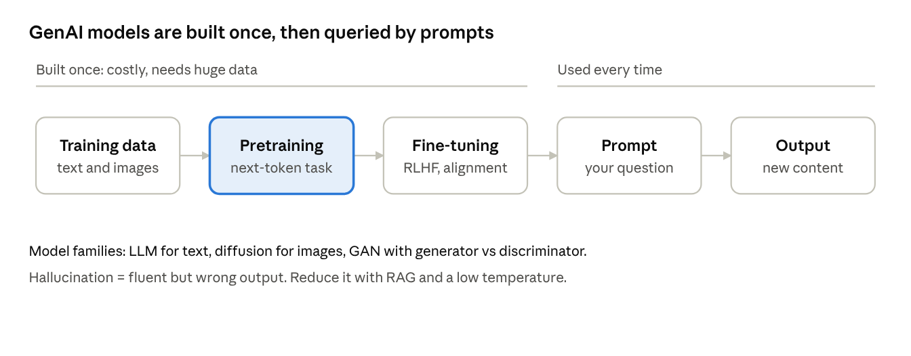<br><sub><i>GenAI lifecycle · build once, prompt many times</i></sub></p>

| Model family | Kaam | Example |
| --- | --- | --- |
| LLM (Transformer) | Text/code generation | GPT, Claude, Gemini |
| Diffusion | Image generation (noise se image) | Stable Diffusion, DALL-E |
| GAN | Generator vs Discriminator ka game | Deepfakes, image synthesis |
| VAE | Latent space se generate | Image/anomaly tasks |

**Key terms:** Prompt, Token, Context window, Hallucination (galat but confident output), Fine-tuning, RAG (Retrieval Augmented Generation: external documents se facts lana).

**How an LLM works (step by step)**

1. Text ko **tokens** mein todte hain (words ya word-pieces).
2. Har token ek **embedding vector** ban jata hai.
3. **Transformer** layers (self-attention) context samajhti hain.
4. Model agle token ki probability predict karta hai, ek token chunta hai, aur ye loop chalta rehta hai jab tak jawab poora na ho.

**Training stages:** Pretraining (internet-scale text par next-token prediction), Instruction fine-tuning (sawal-jawab examples), RLHF ya preference tuning (insaani feedback se behtar aur safe jawab).

**Diffusion models (images):** Training mein image par dheere dheere noise add karte hain, aur model seekhta hai noise hatana. Generation mein pure noise se shuru karke step by step saaf image banate hain, text prompt se guide hokar.

**GAN:** Do networks ka game. Generator nakli data banata hai, Discriminator asli aur nakli mein fark pakadta hai.

```math
\min_G\max_D\; \mathbb{E}[\log D(x)]+\mathbb{E}[\log(1-D(G(z)))]
```

GAN training unstable hoti hai (mode collapse). Isliye image generation mein ab diffusion zyada common hai.

**VAE:** Data ko chhote latent space mein compress karke wapas banata hai. Anomaly detection aur smooth interpolation ke liye useful.

**GenAI use cases**

| Domain | Use |
| --- | --- |
| Text | Chatbots, summarisation, translation, email drafting |
| Code | Autocomplete, bug fixing, test generation |
| Images | Design, marketing creatives, product mockups |
| Audio/Video | Voice cloning, dubbing, video generation |
| Data work | SQL generation, report summaries, data cleaning scripts |

**Limitations:** hallucination, outdated knowledge, bias from training data, prompt injection, privacy leaks if sensitive data paste kiya, copyright questions. **Hamesha important facts verify karo.**

**Adapting a model:** Prompting (sabse sasta) -> RAG (apne documents) -> Fine-tuning (style/behaviour badalna, LoRA se sasta) -> Training from scratch (bahut mehnga).

**Extra glossary:** Multimodal (text + image + audio ek model mein), Agent (model jo tools use karke multi-step kaam kare), Embedding (meaning ka vector), Vector database (embeddings search), LoRA (kam parameters train karke fine-tune), Prompt injection (hidden instructions se model ko bahkana).

### 1.5 Future of AI

- AI agents jo multi-step tasks khud karein
- Multimodal models (text + image + audio ek saath)
- Edge AI (device par hi chalne wala AI)
- AI in healthcare/science (drug discovery, protein folding)
- Challenges: bias, privacy, job displacement, deepfakes, regulation, energy use
- **Responsible AI:** fairness, transparency, accountability, safety

**Major trends to know**

| Trend | Matlab |
| --- | --- |
| AI agents | Model plan banata hai, tools (search, code, APIs) use karta hai, multi-step kaam khud karta hai |
| Multimodal AI | Text, image, audio, video ek saath samajhna aur banana |
| Reasoning models | Jawab dene se pehle step-by-step sochne wale models |
| Small and on-device models | Phone ya laptop par chalne wale halke models, privacy aur speed |
| AI for science | Drug discovery, protein structure, weather and climate modelling |
| Robotics (embodied AI) | Vision + language models se robots ko instructions samjhana |
| AI in analytics | Natural-language se SQL, automated dashboards, insight summaries |

**Risks aur mitigation**

| Risk | Example | Mitigation |
| --- | --- | --- |
| Bias | Hiring model kisi group ko disadvantage de | Diverse data, fairness metrics, audits |
| Privacy | Personal data training ya prompts mein leak | Anonymisation, access control, data policies |
| Misinformation | Deepfakes, fake news at scale | Detection tools, watermarking, media literacy |
| Job impact | Routine tasks automate | Reskilling, AI as assistant, human in the loop |
| Security | Prompt injection, model misuse | Input filtering, red-teaming, least-privilege tools |
| Energy use | Bade models bahut power lete hain | Efficient models, better hardware |

**Regulation (high level):** Duniya bhar mein AI rules ban rahe hain, jaise EU ka AI Act (risk-based approach) aur India ka Digital Personal Data Protection Act, 2023 (personal data ke liye). Interview mein itna jaanna kaafi hai ki regulation risk aur data privacy par focus karti hai.

**Responsible AI principles:** Fairness, Transparency (explainability), Accountability, Privacy, Safety, Human oversight.

**Career angle: data aur AI roles**

| Role | Focus | Key skills |
| --- | --- | --- |
| Data Analyst | Insights, dashboards, reports | SQL, Excel, Power BI/Tableau, stats |
| Data Scientist | Modelling, experiments | Python, ML, statistics, communication |
| ML Engineer | Models ko production mein lana | Python, MLOps, APIs, cloud |
| AI / LLM Engineer | LLM apps, RAG, agents | Prompting, vector DBs, APIs, evaluation |
| MLOps Engineer | Deployment, monitoring, pipelines | Docker, CI/CD, cloud, monitoring |

**Future-proof skills:** strong fundamentals (stats, SQL, Python), problem framing, data storytelling, aur AI tools ko apne kaam mein effectively use karna.

---

## 2. Introduction to Deep Learning

### 2.1 What is Deep Learning?

DL = neural networks jisme **multiple hidden layers** hote hain. Ye raw data (pixels, text) se khud features seekhta hai.

**Why now?** Big data + GPUs + better algorithms.

### 2.2 Perceptron Model

Perceptron = sabse simple neural network (single neuron). Biological neuron se inspired.

<p align="center">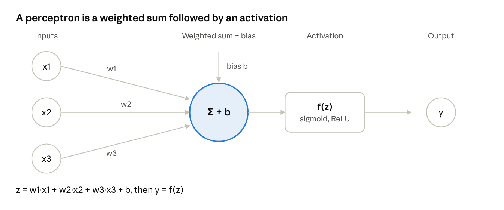<br><sub><i>perceptron · inputs, weights, sum, activation</i></sub></p>

**Formula:** `z = w1x1 + w2x2 + ... + wnxn + b`, then `y = f(z)`

**Learning rule:** `w_new = w_old + lr * (y_true - y_pred) * x`

**Limitation:** Single perceptron sirf **linearly separable** problems solve karta hai. XOR nahi kar sakta. Isliye **Multi-Layer Perceptron (MLP)** aaya: hidden layers + non-linear activation.

<p align="center">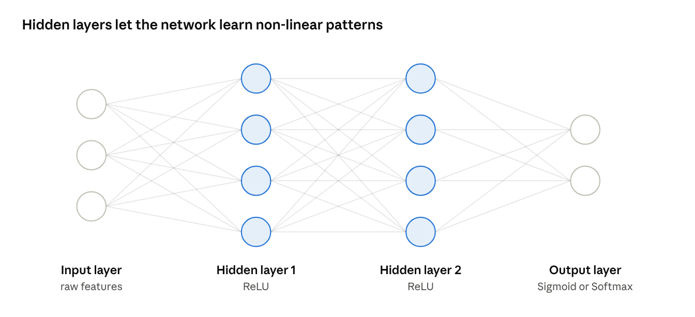<br><sub><i>multi-layer perceptron · 3-4-4-2 network</i></sub></p>

### 2.3 TensorFlow vs PyTorch vs Keras

| Feature | TensorFlow | PyTorch | Keras |
| --- | --- | --- | --- |
| By | Google | Meta (Facebook) | Now part of TensorFlow (multi-backend in Keras 3) |
| Level | Low + high | Low-level, flexible | High-level API |
| Graph | Static + eager | Dynamic (define-by-run) | Abstraction |
| Best for | Production, deployment | Research, debugging | Beginners, quick prototyping |

**Keras example:**

```python
from tensorflow import keras
model = keras.Sequential([
    keras.layers.Dense(64, activation='relu', input_shape=(10,)),
    keras.layers.Dense(1, activation='sigmoid')
])
model.compile(optimizer='adam', loss='binary_crossentropy', metrics=['accuracy'])
model.fit(X_train, y_train, epochs=20, batch_size=32, validation_split=0.2)
```

### 2.4 Types of Neural Networks

| Network | Best for | Key idea |
| --- | --- | --- |
| ANN / MLP | Tabular data | Fully connected layers |
| CNN | Images, video | Convolution filters |
| RNN | Sequences | Hidden state memory |
| LSTM / GRU | Long sequences | Gates control memory |
| Autoencoder | Compression, anomaly | Encoder + decoder |
| GAN | Generation | Generator vs discriminator |
| Transformer | NLP, LLMs | Self-attention |

---

## 3. Artificial Neural Network Deep Dive

### 3.1 Training flow (yaad rakhne wala)

<p align="center">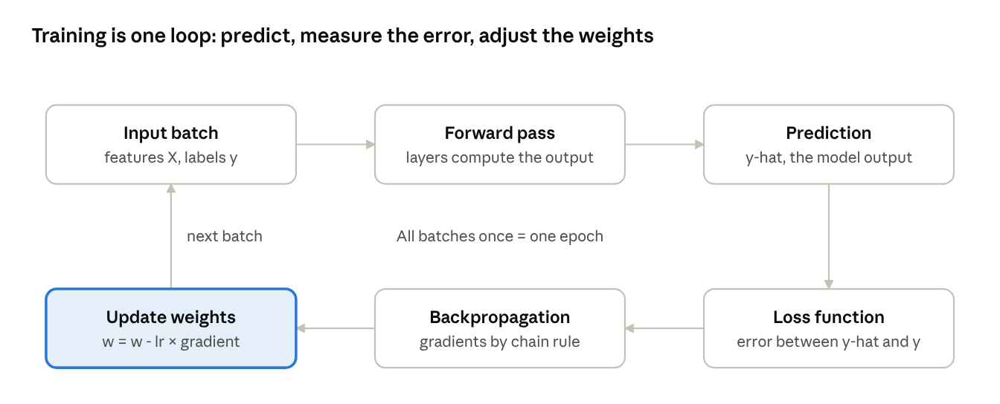<br><sub><i>training loop · 6 steps</i></sub></p>

Ek **epoch** = poora dataset ek baar. **Batch** = ek baar mein kitna data. **Iteration** = ek batch update.

### 3.2 Activation Functions

Non-linearity add karte hain, warna network sirf linear regression ban jata.

| Function | Formula | Range | Use | Problem |
| --- | --- | --- | --- | --- |
| Sigmoid | 1/(1+e^-x) | 0 to 1 | Binary output layer | Vanishing gradient |
| Tanh | (e^x - e^-x)/(e^x + e^-x) | -1 to 1 | Hidden (RNN) | Vanishing gradient |
| ReLU | max(0, x) | 0 to inf | Default for hidden layers | Dying ReLU |
| Leaky ReLU | max(0.01x, x) | -inf to inf | Fixes dying ReLU | Slope to tune |
| Softmax | e^xi / sum(e^xj) | 0 to 1, sum = 1 | Multi-class output | - |

**Rule of thumb:** Hidden = ReLU, Binary output = Sigmoid, Multi-class output = Softmax, Regression output = Linear.

### 3.3 Loss Functions

| Task | Loss | Formula idea |
| --- | --- | --- |
| Regression | MSE | mean of (y - y\_hat)^2 (outliers ko zyada penalise) |
| Regression | MAE | mean of abs(y - y\_hat) (outlier-robust) |
| Regression | Huber | MSE + MAE ka mix |
| Binary classification | Binary Cross-Entropy | -[y log(p) + (1-y) log(1-p)] |
| Multi-class (one-hot) | Categorical Cross-Entropy | -sum(y log p) |
| Multi-class (integer labels) | Sparse Categorical CE | Same, but integer labels |

### 3.4 Optimization Techniques

Goal: loss minimum karna. **Gradient Descent:** `w = w - lr * dLoss/dw`

```
Loss
 |\
 | \        <- learning rate bada = overshoot
 |  \__
 |     \_/   <- minimum
 +----------- weights
```

| Optimizer | Idea |
| --- | --- |
| Batch GD | Poora data ek step ke liye (slow, stable) |
| SGD | Ek sample (fast, noisy) |
| Mini-batch GD | Chhote batches (practical default) |
| Momentum | Past gradients ka average, jaldi converge |
| RMSprop | Per-parameter adaptive learning rate |
| Adagrad | Rare features ko bada update |
| Adam | Momentum + RMSprop (sabse popular default) |

**Learning rate:** bahut chhota = slow, bahut bada = diverge.

### 3.5 Regularization Techniques

Overfitting rokne ke liye (train accuracy high, test accuracy low).

```
Underfit          Good fit          Overfit
  ----             ~~~~             /\/\/\
(too simple)    (just right)      (memorised noise)
```

| Technique | How it works |
| --- | --- |
| L1 (Lasso) | Penalty = sum of abs(w); kuch weights zero ho jate hain |
| L2 (Ridge / weight decay) | Penalty = sum of w^2; weights chhote rakhta hai |
| Dropout | Training mein random neurons off (e.g. 0.5) |
| Early Stopping | Val loss badhne lage to training rok do |
| Data Augmentation | Flip/rotate/zoom se zyada data |
| Batch Normalization | Layer inputs normalise, training stable |

### 3.6 Callbacks (Keras)

Training ke dauran automatically chalne wale functions.

```python
from tensorflow.keras.callbacks import EarlyStopping, ModelCheckpoint, ReduceLROnPlateau
callbacks = [
    EarlyStopping(monitor='val_loss', patience=5, restore_best_weights=True),
    ModelCheckpoint('best.keras', monitor='val_loss', save_best_only=True),
    ReduceLROnPlateau(monitor='val_loss', factor=0.5, patience=3),
]
model.fit(X, y, epochs=100, validation_split=0.2, callbacks=callbacks)
```

Other: TensorBoard (visualisation), LearningRateScheduler, CSVLogger, custom callbacks.

### 3.7 Problems to remember

- **Vanishing gradient:** gradients bahut chhote, early layers seekhte nahi (fix: ReLU, BatchNorm, residual connections, LSTM)
- **Exploding gradient:** gradients bahut bade (fix: gradient clipping)

---

## 4. Computer Vision

Computer Vision (CV) = machines ko images/videos 'dekhna' aur samajhna sikhana.

### 4.1 Tasks ka difference

```
Classification:  'Isme billi hai'            (1 label per image)
Localisation:    'Billi yahan hai' + box      (1 object)
Object Detection:'2 billi, 1 kutta' + boxes   (multiple objects)
Semantic Seg.:   har pixel ka class label     (all cats = same colour)
Instance Seg.:   har object alag mask         (cat1, cat2 alag)
```

### 4.2 Object Detection

Output: **bounding box (x, y, w, h)** + **class** + **confidence score**.

**Key concepts**

- **IoU (Intersection over Union)** = overlap area / union area. IoU > 0.5 usually correct detection.
- **NMS (Non-Max Suppression):** same object ke multiple boxes mein se best rakho, baaki hatao.
- **Anchor boxes:** predefined shapes jinse boxes predict hote hain.
- **mAP (mean Average Precision):** detection ka main metric.

**Two families**

| Two-stage (accurate, slower) | One-stage (fast, real-time) |
| --- | --- |
| R-CNN, Fast R-CNN, Faster R-CNN | YOLO, SSD, RetinaNet |
| Pehle regions propose, phir classify | Ek pass mein box + class |

### 4.3 Region Proposal Techniques

Sawal: image mein object kahan ho sakta hai? Har jagah check karna (sliding window) bahut slow hai.

| Method | Idea |
| --- | --- |
| Sliding window | Har location + size try karo (very slow) |
| Selective Search | Similar colour/texture/size wale regions merge karke \~2000 proposals (R-CNN) |
| RPN (Region Proposal Network) | CNN khud proposals seekhta hai (Faster R-CNN) |

**Evolution:**

<p align="center">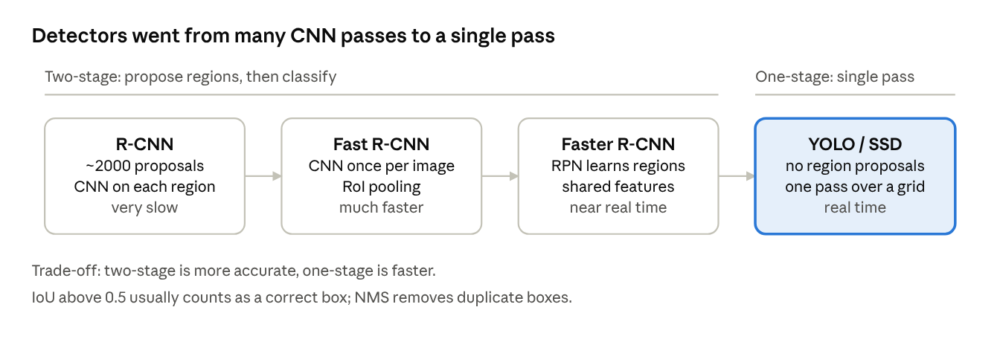<br><sub><i>object detection evolution · R-CNN to YOLO</i></sub></p>

### 4.4 Semantic Segmentation

Har pixel ko class label dena. Output = image jitna bada mask.

<p align="center">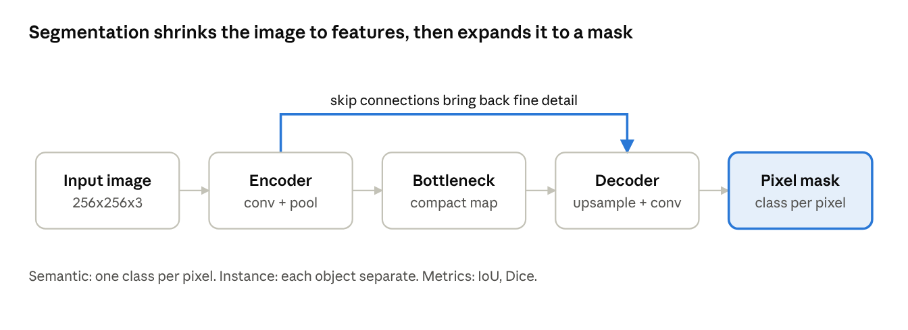<br><sub><i>segmentation encoder-decoder with skip connections</i></sub></p>

- **U-Net:** encoder-decoder + skip connections (medical imaging mein popular)
- **FCN:** fully convolutional network
- **DeepLab:** atrous (dilated) convolution
- **Mask R-CNN:** instance segmentation
- **Metrics:** IoU / Dice coefficient / pixel accuracy

---

## 5. Computer Vision with OpenCV: Images, Video, OCR, MediaPipe

### 5.1 Working with Images

Image = pixels ka matrix. Grayscale = 2D (H x W), Colour = 3D (H x W x 3). **OpenCV BGR order use karta hai, RGB nahi.**

```python
import cv2
img = cv2.imread('photo.jpg')                  # read (BGR)
gray = cv2.cvtColor(img, cv2.COLOR_BGR2GRAY)   # grayscale
resized = cv2.resize(img, (300, 300))          # resize
blur = cv2.GaussianBlur(img, (5, 5), 0)        # blur / denoise
edges = cv2.Canny(gray, 100, 200)              # edge detection
_, thresh = cv2.threshold(gray, 127, 255, cv2.THRESH_BINARY)
cv2.rectangle(img, (50, 50), (200, 200), (0, 255, 0), 2)
cv2.imwrite('out.jpg', img)
```

**Common operations:** crop, rotate, flip, thresholding, morphology (erode/dilate), contours, histogram equalisation.

### 5.2 Working with Videos

Video = frames ka sequence. Loop mein frame by frame process karo.

```python
cap = cv2.VideoCapture(0)          # 0 = webcam, ya 'video.mp4'
while True:
    ret, frame = cap.read()
    if not ret: break
    gray = cv2.cvtColor(frame, cv2.COLOR_BGR2GRAY)
    cv2.imshow('Live', gray)
    if cv2.waitKey(1) & 0xFF == ord('q'): break
cap.release(); cv2.destroyAllWindows()
```

Save video: `cv2.VideoWriter` + codec (fourcc). Use cases: motion detection, tracking, surveillance.

### 5.3 OCR (Tesseract)

OCR = image se text nikalna.

```
Image --> Preprocess (gray, threshold, denoise) --> Text detection --> Recognition --> Text
```

```python
import cv2, pytesseract
img = cv2.imread('doc.png')
gray = cv2.cvtColor(img, cv2.COLOR_BGR2GRAY)
_, th = cv2.threshold(gray, 150, 255, cv2.THRESH_BINARY)
text = pytesseract.image_to_string(th, lang='eng')
boxes = pytesseract.image_to_data(th, output_type=pytesseract.Output.DICT)  # word boxes
```

**Accuracy tips:** high resolution, good contrast, deskew, noise removal. Tesseract engine install karna padta hai (pytesseract sirf wrapper hai). Alternatives: EasyOCR, PaddleOCR.

### 5.4 MediaPipe (FaceMesh, Pose Detection)

Google ka ready-made, real-time ML framework (lightweight, CPU par bhi chalta hai).

| Solution | Output |
| --- | --- |
| Face Mesh | 468 3D face landmarks |
| Pose | 33 body landmarks |
| Hands | 21 landmarks per hand |

```python
import mediapipe as mp, cv2
mp_pose = mp.solutions.pose
with mp_pose.Pose(min_detection_confidence=0.5) as pose:
    rgb = cv2.cvtColor(frame, cv2.COLOR_BGR2RGB)   # MediaPipe needs RGB
    result = pose.process(rgb)
    # result.pose_landmarks -> x, y, z, visibility
```

**Uses:** AR filters, fitness rep counter, yoga posture check, gesture control, drowsiness detection.

---

## 6. Convolutional Neural Network (CNN)

### 6.1 Why CNN?

Image par ANN use karo to parameters explode ho jate hain (224x224x3 = 150k inputs) aur spatial structure khatam. CNN **local patterns** seekhta hai aur **weights share** karta hai.

### 6.2 Architecture

<p align="center">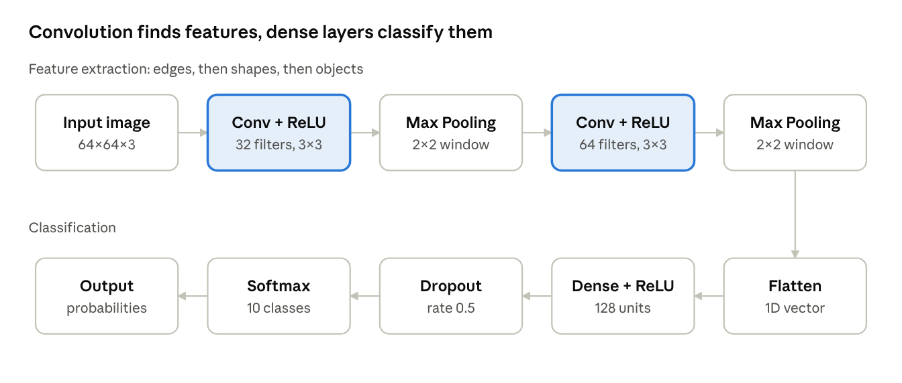<br><sub><i>CNN architecture · feature extraction then classification</i></sub></p>

**Kernel / Filter:** chhota matrix (3x3, 5x5) jo image par slide karke feature map banata hai. Early layers = edges, deeper = shapes, objects.

```
Image patch      Kernel        Feature map value
[1 2 0]          [1 0 -1]
[0 1 3]    *     [1 0 -1]   =   sum of element-wise products
[2 1 0]          [1 0 -1]
```

**Stride:** filter ek baar mein kitne pixel jump kare. Bada stride = chhota output.

**Padding:** border par zeros add karna.

- Valid = no padding (output shrinks)
- Same = padding so output size = input size

**Output size formula:** `O = (N - F + 2P) / S + 1` Example: N=32, F=3, P=0, S=1 gives O = 30.

**Pooling:** downsampling, parameters kam, thodi translation invariance.

- Max pooling: window ka maximum (strong features)
- Average pooling: window ka average (smooth)

```
Max Pool 2x2:  [1 3 | 2 4]        [3 | 4]
               [5 6 | 7 8]   -->  [6 | 8]
```

**Activation:** ReLU conv ke baad. **Flatten:** 2D maps ko 1D vector. **Dense + Softmax:** final classification.

```python
model = keras.Sequential([
    keras.layers.Conv2D(32, (3,3), activation='relu', input_shape=(64,64,3)),
    keras.layers.MaxPooling2D((2,2)),
    keras.layers.Conv2D(64, (3,3), activation='relu'),
    keras.layers.MaxPooling2D((2,2)),
    keras.layers.Flatten(),
    keras.layers.Dense(128, activation='relu'),
    keras.layers.Dropout(0.5),
    keras.layers.Dense(10, activation='softmax')
])
```

**Famous CNNs:** LeNet, AlexNet, VGG, ResNet (skip connections), Inception, MobileNet, EfficientNet. **Transfer learning:** pretrained model (ImageNet) ko apne data par fine-tune karo.

---

## 7. NLP: Sentiment Analysis on Amazon Reviews

NLP = machines ko human language samajhna sikhana.

### 7.1 NLP Pipeline

<p align="center">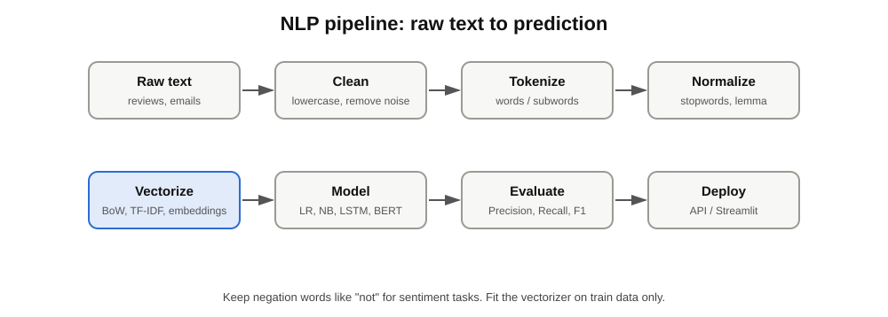<br><sub><i>NLP pipeline · 5 stages</i></sub></p>

### 7.2 Text Preprocessing

| Step | What | Example |
| --- | --- | --- |
| Lowercasing | Sab small | 'Great' becomes 'great' |
| Remove punctuation/numbers/HTML/URLs | Noise hatao |  |
| Tokenization | Words mein todo | 'good phone' becomes ['good','phone'] |
| Stopword removal | is, the, a hatao | Note: 'not' ko sentiment mein mat hatao |
| Stemming | Root cut (fast, crude) | 'running' becomes 'run', 'studies' becomes 'studi' |
| Lemmatization | Proper dictionary root (better) | 'better' becomes 'good' |
| POS tagging / NER | Grammar tags / named entities |  |

### 7.3 Text Vectorization

| Method | Idea | Pros / Cons |
| --- | --- | --- |
| Bag of Words | Word counts | Simple; order aur meaning lost |
| N-grams | Word pairs/triples | Thoda context; bada vocabulary |
| TF-IDF | TF x IDF; common words ka weight kam | Better than BoW; still no semantics |
| Word2Vec / GloVe | Dense vectors, similar words paas | Semantics capture; ek word = ek vector |
| Transformer embeddings (BERT) | Context-aware vectors | Best; heavy |

**TF-IDF:** `TF = count of word in doc / total words`, `IDF = log(N / docs containing word)`

**Classification models:** Naive Bayes, Logistic Regression, SVM, Random Forest (TF-IDF ke saath fast baseline).

### 7.4 Embedding Layer

Embedding layer = integer word ID ko **dense learnable vector** mein badalta hai.

```
'good' -> ID 42 -> Embedding Matrix (vocab x dim) -> [0.12, -0.5, 0.8, ...]
```

Train ke dauran ye vectors seekhe jate hain, similar words paas aate hain. Pretrained GloVe/Word2Vec bhi load kar sakte ho.

### 7.5 Sentiment Analysis (Amazon Reviews)

Task: review ko Positive / Negative / Neutral classify karna.

```python
from sklearn.feature_extraction.text import TfidfVectorizer
from sklearn.linear_model import LogisticRegression
from sklearn.model_selection import train_test_split
from sklearn.metrics import classification_report

X_train, X_test, y_train, y_test = train_test_split(df['clean_review'], df['label'], test_size=0.2, stratify=df['label'])
vec = TfidfVectorizer(max_features=5000, ngram_range=(1,2))
clf = LogisticRegression(max_iter=1000).fit(vec.fit_transform(X_train), y_train)
print(classification_report(y_test, clf.predict(vec.transform(X_test))))
```

**Practical tips:** class imbalance dhyan se (F1 dekho, sirf accuracy nahi); rating 4-5 = positive, 1-2 = negative, 3 = neutral/drop; negation handle karo.

**DL version:** Tokenizer -> pad\_sequences -> Embedding -> LSTM/GRU -> Dense(sigmoid).

### 7.6 Email Spam Detection

Binary classification: spam vs ham. Pipeline: clean -> TF-IDF -> Multinomial Naive Bayes (classic best baseline). **Metrics:** Precision important (ham ko spam mat bolo), Recall, F1, Confusion matrix.

### 7.7 Machine Translation

Source language ko target language mein convert karna.

<p align="center">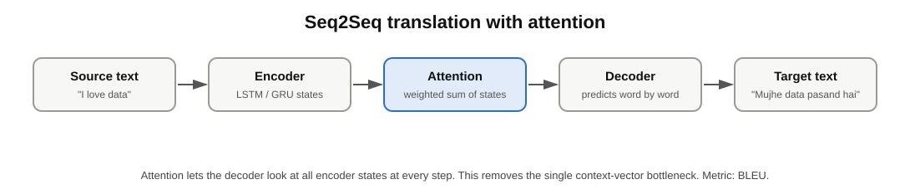<br><sub><i>seq2seq translation with attention</i></sub></p>

**Metric:** BLEU score. **Evolution:** Rule-based -> Statistical -> Seq2Seq -> Attention -> Transformer.

### 7.8 Introduction to LLMs and the OpenAI API

LLM = bahut bade Transformer models jo huge text par train hue hain, next token predict karke text generate karte hain.

**Transformer core idea:** Self-Attention (har word dekhta hai ki baaki words kitne relevant hain), poori sequence parallel process hoti hai.

**Training stages:** Pretraining -> Instruction fine-tuning -> RLHF (human feedback).

**Key parameters:** `temperature` (randomness), `max_tokens`, `top_p`, `system / user / assistant` roles.

```python
from openai import OpenAI
client = OpenAI(api_key='YOUR_KEY')   # key hamesha environment variable mein rakho
resp = client.chat.completions.create(
    model='gpt-4o-mini',
    messages=[
        {'role': 'system', 'content': 'You are a helpful assistant.'},
        {'role': 'user', 'content': 'Explain overfitting in 2 lines.'}
    ],
    temperature=0.7, max_tokens=150
)
print(resp.choices[0].message.content)
```

**Prompt engineering:** clear instruction, role, examples (few-shot), step-by-step reasoning, output format specify karo.

---

## 8. Sequence Models and Fake News Detection

### 8.1 RNN (Recurrent Neural Network)

Sequence data (text, time series, speech) ke liye. **Hidden state** pichle steps ki memory rakhta hai.

<p align="center">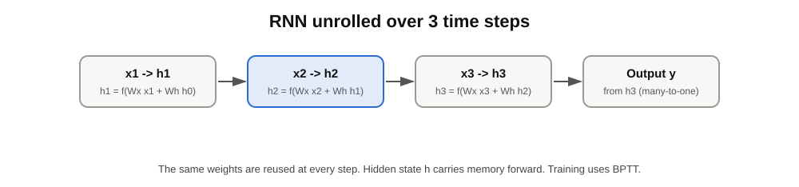<br><sub><i>RNN unrolled over 3 time steps</i></sub></p>

**Types:** one-to-one, one-to-many (image captioning), many-to-one (sentiment), many-to-many (translation).

**Problem:** Vanishing gradient, isliye long-term dependencies yaad nahi rehti. **Training:** BPTT (Backpropagation Through Time).

### 8.2 LSTM (Long Short-Term Memory)

Cell state (conveyor belt) + 3 gates se long memory.

<p align="center">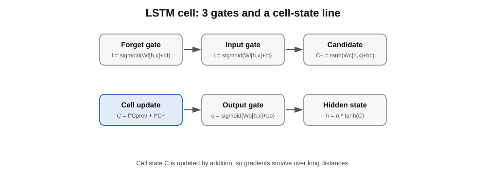<br><sub><i>LSTM cell · 3 gates and a cell-state line</i></sub></p>

| Gate | Kaam |
| --- | --- |
| Forget gate | Purani info kitni bhoolni hai |
| Input gate | Nayi info kitni store karni hai |
| Output gate | Cell se kitna output dena hai |

### 8.3 GRU (Gated Recurrent Unit)

LSTM ka simplified version: **2 gates** (Update, Reset), cell state nahi.

|  | RNN | LSTM | GRU |
| --- | --- | --- | --- |
| Gates | 0 | 3 | 2 |
| Long memory | Weak | Strong | Strong |
| Speed / parameters | Fastest | Slowest, most | Faster than LSTM |

**Bidirectional RNN:** sequence ko aage aur peeche dono taraf se padhta hai (context behtar).

### 8.4 Fake News Detection

Binary classification: Real vs Fake.

<p align="center">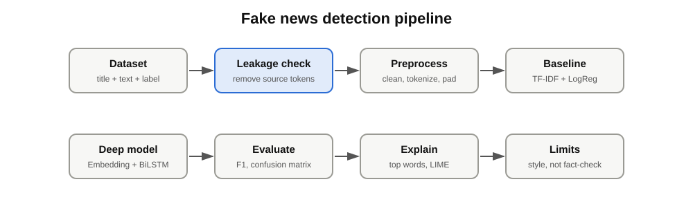<br><sub><i>fake news detection pipeline</i></sub></p>

```python
model = keras.Sequential([
    keras.layers.Embedding(10000, 64, input_length=200),
    keras.layers.Bidirectional(keras.layers.LSTM(64)),
    keras.layers.Dropout(0.5),
    keras.layers.Dense(1, activation='sigmoid')
])
model.compile(loss='binary_crossentropy', optimizer='adam', metrics=['accuracy'])
```

**Baseline compare karo:** TF-IDF + Logistic Regression / Passive Aggressive Classifier. **Metrics:** Precision, Recall, F1, Confusion Matrix. **Caution:** data leakage (source name / dataset artifacts) se fake high accuracy aa sakti hai.

---

## 9. Chatbot

| Type | How | Example |
| --- | --- | --- |
| Rule-based | If-else / pattern matching | FAQ bot |
| Retrieval-based | Predefined responses mein se best chunta hai | Intent classifier |
| Generative | Naya response generate (Seq2Seq / LLM) | ChatGPT-style |

**Architecture**

<p align="center">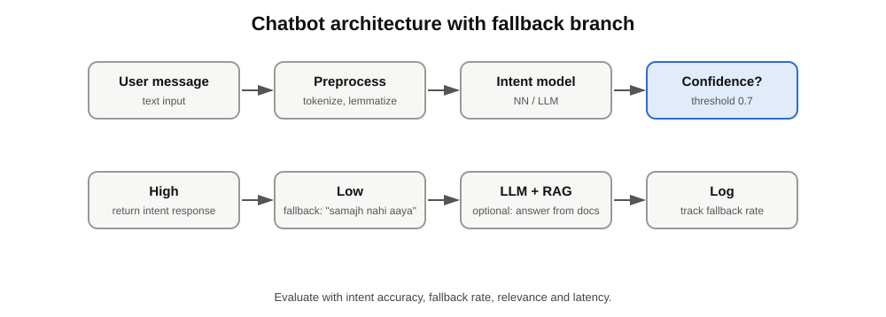<br><sub><i>chatbot architecture with fallback branch</i></sub></p>

**Intent-based chatbot steps**

1. `intents.json` banao (tag, patterns, responses)
2. Patterns ko tokenize + lemmatize
3. Bag-of-words / embeddings banao
4. Neural network train karo (intent classify)
5. Predict karke us tag ka response return karo
6. Confidence threshold set karo (low confidence par 'Samajh nahi aaya')

**LLM chatbot:** conversation history messages list mein bhejo (memory), system prompt se personality/rules set karo. **RAG** se apne documents par answer do. Deploy: Streamlit / Flask.

---

## 10. Time Series Analysis

Time series = time ke order mein collected data (daily sales, temperature, stock price). **Order matter karta hai**, isliye random train-test split nahi karte.

### 10.1 Time Series Data in ML

**Components**

- **Trend:** lambe time ka up/down direction
- **Seasonality:** fixed period par repeat pattern (har December sales up)
- **Cyclic:** irregular lambe cycles (economic cycles)
- **Noise / Residual:** random variation

**Applications:** sales forecasting, demand planning, weather, stock, energy load, anomaly detection.

### 10.2 Working with Time Series in Python

```python
import pandas as pd
df = pd.read_csv('data.csv', parse_dates=['date'], index_col='date')
df = df.asfreq('D')                          # fixed frequency
df['value'] = df['value'].interpolate()      # missing fill
monthly = df['value'].resample('M').mean()   # resample
df['roll_7'] = df['value'].rolling(7).mean() # rolling mean
df['lag_1'] = df['value'].shift(1)           # lag feature
train, test = df[:'2024-06'], df['2024-07':] # time-based split
```

### 10.3 Stationarity

Stationary = mean, variance aur autocorrelation time ke saath **constant**. Zyada tar classical models (ARIMA) ko stationary data chahiye.

**Check karne ke tareeke**

- Visual: rolling mean/std plot
- **ADF test:** H0 = non-stationary. **p < 0.05 means stationary.**
- **KPSS test:** H0 = stationary (ulta)

**Stationary banane ke tareeke:** Differencing, Log / sqrt transform (variance ke liye), Seasonal differencing, Detrending.

```python
from statsmodels.tsa.stattools import adfuller
print(adfuller(series.dropna())[1])   # p-value
diff = series.diff().dropna()          # 1st-order differencing
```

### 10.4 Time Series Decomposition

```
Additive:        Y = Trend + Seasonality + Residual   (seasonal swing constant)
Multiplicative:  Y = Trend x Seasonality x Residual   (swing level ke saath badhe)
```

```python
from statsmodels.tsa.seasonal import seasonal_decompose
seasonal_decompose(series, model='additive', period=12).plot()
```

Advanced: STL decomposition (robust, flexible).

### 10.5 Pattern Recognition: ACF and PACF

- **ACF:** series ka apne lags se total correlation
- **PACF:** lag ka direct correlation (beech ke lags hata kar)

```
AR(p): PACF p lag ke baad cut off,  ACF slowly decay
MA(q): ACF  q lag ke baad cut off,  PACF slowly decay
```

**Baaki patterns:** autocorrelation, seasonality spikes, white noise (koi pattern nahi), random walk.

---

## 11. Weather Forecasting using ARIMA and SARIMA

### 11.1 AR and MA Models

- **AR(p):** aaj ki value = pichli p values ka linear combination `Y(t) = c + a1 Y(t-1) + ... + ap Y(t-p) + error`
- **MA(q):** aaj ki value = pichle q errors ka combination `Y(t) = c + error(t) + b1 error(t-1) + ... + bq error(t-q)`

### 11.2 ARIMA(p, d, q)

<p align="center">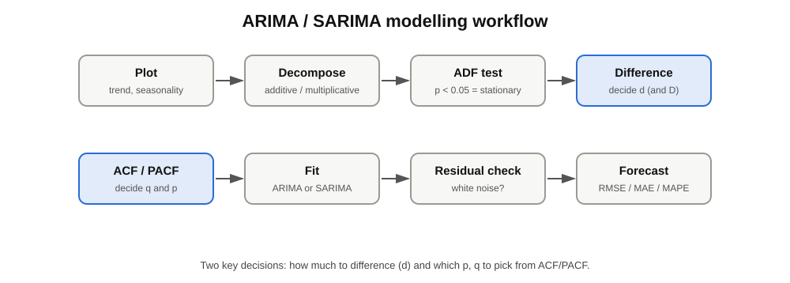<br><sub><i>ARIMA / SARIMA modelling workflow · 2 decisions</i></sub></p>

| Param | Meaning | Kaise choose karein |
| --- | --- | --- |
| p | AR order | PACF cut-off |
| d | Differencing count | ADF test se (usually 0, 1, 2) |
| q | MA order | ACF cut-off |

### 11.3 SARIMA(p,d,q)(P,D,Q,m)

ARIMA + **seasonal** component. `m` = season length (monthly data m=12, daily with weekly pattern m=7). SARIMAX = SARIMA + exogenous variables (e.g. holiday, humidity).

| ARIMA | SARIMA |
| --- | --- |
| Non-seasonal data | Seasonal data (weather, sales) |
| 3 parameters | 7 parameters |

### 11.4 Implementation

```python
from statsmodels.tsa.statespace.sarimax import SARIMAX
from sklearn.metrics import mean_squared_error
import numpy as np

model = SARIMAX(train, order=(1,1,1), seasonal_order=(1,1,1,12))
res = model.fit(disp=False)
print(res.summary())                      # AIC, coefficients

forecast = res.get_forecast(steps=len(test))
pred = forecast.predicted_mean
ci = forecast.conf_int()                  # confidence interval
print('RMSE:', np.sqrt(mean_squared_error(test, pred)))
```

**Auto selection:** `pmdarima.auto_arima(train, seasonal=True, m=12)` ya AIC/BIC grid search (**lower AIC = better**).

**Workflow**

```
Plot -> Decompose -> ADF test -> Differencing -> ACF/PACF -> Pick (p,d,q)
 -> Fit -> Residual check (white noise?) -> Forecast -> RMSE/MAE/MAPE
```

**Metrics:** MAE, RMSE, MAPE.

---

## 12. Stock Price Prediction using Sequence Models (LSTM)

### 12.1 Pipeline

```
Historical prices -> Scale (MinMax) -> Windows (60 days -> next day) -> LSTM -> Predict -> Inverse scale
```

### 12.2 Preparing Data for LSTM

LSTM input shape: **(samples, time\_steps, features)**.

```python
from sklearn.preprocessing import MinMaxScaler
import numpy as np

scaler = MinMaxScaler()
scaled = scaler.fit_transform(prices.reshape(-1, 1))   # fit sirf train par ideally

def make_windows(data, n=60):
    X, y = [], []
    for i in range(n, len(data)):
        X.append(data[i-n:i, 0]); y.append(data[i, 0])
    return np.array(X)[..., None], np.array(y)

X, y = make_windows(scaled)
split = int(0.8 * len(X))                      # time-based split, shuffle nahi
X_train, X_test, y_train, y_test = X[:split], X[split:], y[:split], y[split:]
```

### 12.3 Forecasting using LSTM

```python
model = keras.Sequential([
    keras.layers.LSTM(50, return_sequences=True, input_shape=(60, 1)),
    keras.layers.Dropout(0.2),
    keras.layers.LSTM(50),
    keras.layers.Dropout(0.2),
    keras.layers.Dense(1)
])
model.compile(optimizer='adam', loss='mse')
model.fit(X_train, y_train, epochs=30, batch_size=32, validation_split=0.1,
          callbacks=[keras.callbacks.EarlyStopping(patience=5, restore_best_weights=True)])
pred = scaler.inverse_transform(model.predict(X_test))
```

**Evaluate:** RMSE / MAE / MAPE + actual vs predicted plot.

### 12.4 Future Forecast

Recursive forecasting: last window se next predict karo, usse window mein add karo, repeat.

```python
window = X_test[-1].copy(); future = []
for _ in range(30):
    nxt = model.predict(window[None, ...], verbose=0)[0, 0]
    future.append(nxt)
    window = np.vstack([window[1:], [[nxt]]])
future = scaler.inverse_transform(np.array(future).reshape(-1, 1))
```

**Important honesty point:** stock prices noisy aur market news se drive hote hain. Model sirf past pattern seekhta hai, isliye long-term forecast error badhta jata hai. Ise **learning/portfolio project** samjho, trading advice nahi. Compare with naive baseline (kal ki price = aaj ki price).

---

## 13. Quick Revision Cheat Sheet

| Problem | Go-to approach |
| --- | --- |
| Tabular classification/regression | ML models (XGBoost, RF) ya MLP |
| Image classification | CNN / transfer learning (ResNet, MobileNet) |
| Object detection | YOLO / Faster R-CNN |
| Pixel-level labelling | U-Net / DeepLab |
| Text classification | TF-IDF + LR, ya LSTM / BERT |
| Sequence / text generation | LSTM / GRU / Transformer |
| Seasonal time series | SARIMA / Prophet / LSTM |
| Extract text from images | OCR (Tesseract) |

**Top interview questions (short answers)**

1. **Overfitting kya hai, kaise roken?** Model train data memorise kar le; Dropout, L1/L2, early stopping, more data, augmentation.
2. **Why non-linear activation?** Bina uske deep network bhi linear model hi hai.
3. **ReLU kyun popular?** Simple, fast, vanishing gradient kam; dying ReLU ka risk.
4. **Why LSTM over RNN?** Gates + cell state se long-term dependency handle hoti hai.
5. **CNN vs ANN for images?** Weight sharing, local patterns, kam parameters.
6. **Stationarity kyun zaruri?** ARIMA jaise models stable statistical properties assume karte hain.
7. **Stemming vs Lemmatization?** Stemming crude cut; lemmatization dictionary-based valid root.
8. **TF-IDF kya hai?** Word importance = frequency x rarity across documents.
9. **Accuracy ke alawa kya?** Imbalanced data mein Precision, Recall, F1, ROC-AUC.
10. **Time series mein random split kyun nahi?** Future data leak ho jata hai; hamesha time-based split.

**Study order suggestion:** 1 -> 2 -> 3 (foundation, sabse important) -> 6 -> 7 -> 8 -> 10 -> 11. Data Analyst / Data Scientist interviews mein sections 3, 7, 10, 11 aur evaluation metrics sabse zyada poochhe jate hain.

---

# Part 2: Deep Dive Notes (details, math, worked examples)

Part 1 mein concepts aur diagrams the. Yahan har module ko gehrai mein samjhaya hai: formulas, numeric examples, extra code, common mistakes aur interview points.

## 14. Deep Dive: ML Basics, Perceptron and ANN

### 14.1 Standard ML workflow

Collect data, clean, EDA, feature engineering, split, train, evaluate, tune, deploy. Typical split: **70% train, 15% validation, 15% test**. Test set ko sirf end mein ek baar use karo.

**Bias-variance tradeoff:** High bias = underfit (model bahut simple). High variance = overfit (train mein achha, test mein bura). Goal: dono ke beech sweet spot.

### 14.2 Evaluation metrics (formulas)

```math
\text{Accuracy}=\frac{TP+TN}{TP+TN+FP+FN},\quad \text{Precision}=\frac{TP}{TP+FP},\quad \text{Recall}=\frac{TP}{TP+FN}
```

```math
F1=2\cdot\frac{\text{Precision}\cdot\text{Recall}}{\text{Precision}+\text{Recall}}
```

| Metric | Kab use karein |
| --- | --- |
| Accuracy | Balanced classes |
| Precision | False positive costly (spam filter) |
| Recall | False negative costly (disease detection, fraud) |
| F1 | Imbalanced data, precision-recall balance |
| ROC-AUC | Threshold-independent ranking quality |
| MAE / RMSE | Regression error (RMSE outliers ko zyada penalise karta hai) |
| R2 | Model kitna variance explain karta hai |

### 14.3 Perceptron worked example: AND gate

Weights w1 = 1, w2 = 1, bias b = -1.5, step activation (z > 0 gives 1).

| x1 | x2 | z = x1 + x2 - 1.5 | Output |
| --- | --- | --- | --- |
| 0 | 0 | -1.5 | 0 |
| 0 | 1 | -0.5 | 0 |
| 1 | 0 | -0.5 | 0 |
| 1 | 1 | 0.5 | 1 |

**XOR** ek straight line se alag nahi hota, isliye single perceptron fail hota hai. Hidden layer (MLP) XOR solve kar leta hai.

### 14.4 Forward pass: numeric example

Input x = [2, 3], weights w = [0.5, -1], bias b = 1.

`z = 0.5*2 + (-1)*3 + 1 = -1`

| Activation | Output for z = -1 |
| --- | --- |
| Sigmoid | 1/(1+e^1) = 0.269 |
| Tanh | -0.762 |
| ReLU | 0 |

### 14.5 Backpropagation (chain rule)

Backprop loss ka gradient har weight tak peeche ki taraf chain rule se pahunchata hai.

```math
\frac{\partial L}{\partial w}=\frac{\partial L}{\partial \hat y}\cdot\frac{\partial \hat y}{\partial z}\cdot\frac{\partial z}{\partial w}
```

Update: `w = w - lr * dL/dw`. Frameworks (TensorFlow, PyTorch) ye gradients automatically nikalte hain (autograd).

### 14.6 Activation functions in more detail

```math
\sigma(z)=\frac{1}{1+e^{-z}},\quad \sigma'(z)=\sigma(z)(1-\sigma(z))\le 0.25,\quad \text{softmax}(z_i)=\frac{e^{z_i}}{\sum_j e^{z_j}}
```

- Sigmoid ka derivative max 0.25 hai. Kai layers multiply hone par gradient lagbhag 0 ho jata hai: **vanishing gradient**.
- **ReLU** ka derivative 1 (positive side) hai, isliye gradient flow achha. Negative side par 0, isse neuron 'mar' sakta hai (dying ReLU).
- Modern options: **ELU, GELU** (Transformers/BERT), **Swish**.
- Softmax outputs ka sum 1 hota hai, isliye probabilities jaisa behave karta hai.

### 14.7 Weight initialization

| Method | Kab |
| --- | --- |
| Xavier / Glorot | Sigmoid, tanh |
| He initialization | ReLU family (Keras mein `kernel_initializer='he_normal'`) |
| All zeros | **Kabhi nahi**: sab neurons same seekhte hain (symmetry problem) |

### 14.8 Loss functions: formulas and why

```math
MSE=\frac1n\sum(y-\hat y)^2,\quad BCE=-\frac1n\sum\big[y\log\hat y+(1-y)\log(1-\hat y)\big]
```

Classification mein **cross-entropy** isliye, kyunki wrong confident prediction ko bahut bada penalty milta hai aur gradient sigmoid/softmax ke saath achha behave karta hai. MSE classification par slow seekhta hai.

### 14.9 Optimizers in more detail

```math
\text{Momentum: } v_t=\beta v_{t-1}+\nabla L,\; w=w-\eta v_t
```

```math
\text{Adam: } m_t=\beta_1 m_{t-1}+(1-\beta_1)g_t,\; v_t=\beta_2 v_{t-1}+(1-\beta_2)g_t^2,\; w=w-\eta\frac{\hat m_t}{\sqrt{\hat v_t}+\epsilon}
```

Adam defaults: lr = 0.001, beta1 = 0.9, beta2 = 0.999.

| Batch size | Effect |
| --- | --- |
| Small (16-32) | Noisy updates, better generalisation, slower per epoch |
| Large (256+) | Stable, fast on GPU, may generalise worse |

**Learning rate schedules:** step decay, exponential decay, ReduceLROnPlateau, cosine annealing, warm-up.

### 14.10 Regularization in more detail

```math
L1:\; L+\lambda\sum|w|,\qquad L2:\; L+\lambda\sum w^2
```

- **Dropout** sirf training mein active, inference mein off. Typical rate 0.2-0.5.
- **BatchNorm** activations ko normalise karta hai: training fast, thoda regularising effect.
- **Early stopping** sabse sasta aur effective method.

### 14.11 Complete ANN example (tabular classification)

```python
import numpy as np, pandas as pd
from sklearn.model_selection import train_test_split
from sklearn.preprocessing import StandardScaler
from sklearn.metrics import classification_report
from tensorflow import keras

X_train, X_test, y_train, y_test = train_test_split(X, y, test_size=0.2, stratify=y, random_state=42)
scaler = StandardScaler()
X_train = scaler.fit_transform(X_train)   # fit sirf train par
X_test = scaler.transform(X_test)

model = keras.Sequential([
    keras.layers.Dense(64, activation='relu', kernel_initializer='he_normal', input_shape=(X_train.shape[1],)),
    keras.layers.BatchNormalization(),
    keras.layers.Dropout(0.3),
    keras.layers.Dense(32, activation='relu'),
    keras.layers.Dense(1, activation='sigmoid')
])
model.compile(optimizer=keras.optimizers.Adam(1e-3), loss='binary_crossentropy', metrics=['accuracy', keras.metrics.AUC(name='auc')])
hist = model.fit(X_train, y_train, validation_split=0.2, epochs=100, batch_size=32,
                 callbacks=[keras.callbacks.EarlyStopping(patience=8, restore_best_weights=True)], verbose=0)
print(classification_report(y_test, (model.predict(X_test) > 0.5).astype(int)))
```

### 14.12 Debugging checklist

| Symptom | Likely cause | Fix |
| --- | --- | --- |
| Loss NaN | Learning rate too high, bad scaling | Lower lr, scale inputs, clip gradients |
| Loss not decreasing | lr too low/high, bug, no scaling | Overfit 1 small batch first; check labels |
| Train good, val bad | Overfitting | Dropout, L2, more data, early stopping |
| Both bad | Underfitting | Bigger model, more epochs, better features |
| Val loss jumps around | lr high or small val set | Lower lr, bigger batch |

---

## 15. Deep Dive: Computer Vision, OpenCV and CNN

### 15.1 Image fundamentals

- Pixel value 0-255 (8-bit). Grayscale = 1 channel, colour = 3 channels (OpenCV: BGR).
- **HSV** colour space (Hue, Saturation, Value) colour-based detection ke liye RGB se behtar hai.
- Neural networks ke liye images ko 0-1 range mein normalise karo (`img / 255.0`).

### 15.2 Object detection in more detail

```math
IoU=\frac{\text{Area of overlap}}{\text{Area of union}}
```

**NMS algorithm:** (1) boxes ko confidence se sort karo, (2) sabse high box rakho, (3) uske saath IoU > threshold wale boxes hatao, (4) bache hue par repeat.

**YOLO idea:** image ko S x S grid mein baantta hai. Har cell B boxes aur C class probabilities predict karta hai. Output tensor: `S x S x (B*5 + C)` (har box: x, y, w, h, confidence).

**Metrics:** Precision, Recall, **AP** (precision-recall curve ke neeche area), **mAP** (sab classes ka average AP, e.g. mAP@0.5).

### 15.3 Segmentation in more detail

```math
Dice=\frac{2|A\cap B|}{|A|+|B|}
```

- **U-Net:** encoder (downsample) + decoder (upsample) + **skip connections** jo fine details wapas laate hain. Medical images mein bahut popular.
- **Semantic:** class per pixel. **Instance:** har object alag (Mask R-CNN). **Panoptic:** dono ka mix.

### 15.4 OpenCV recipes

**Colour detection (HSV mask):**

```python
hsv = cv2.cvtColor(img, cv2.COLOR_BGR2HSV)
mask = cv2.inRange(hsv, (35, 50, 50), (85, 255, 255))      # green range
result = cv2.bitwise_and(img, img, mask=mask)
```

**Contours:**

```python
gray = cv2.cvtColor(img, cv2.COLOR_BGR2GRAY)
_, th = cv2.threshold(gray, 127, 255, cv2.THRESH_BINARY_INV)
contours, _ = cv2.findContours(th, cv2.RETR_EXTERNAL, cv2.CHAIN_APPROX_SIMPLE)
for c in contours:
    if cv2.contourArea(c) > 500:
        x, y, w, h = cv2.boundingRect(c)
        cv2.rectangle(img, (x, y), (x + w, y + h), (0, 255, 0), 2)
```

**Face detection (Haar cascade):**

```python
face_cascade = cv2.CascadeClassifier(cv2.data.haarcascades + 'haarcascade_frontalface_default.xml')
faces = face_cascade.detectMultiScale(gray, scaleFactor=1.1, minNeighbors=5)
```

**OCR preprocessing (low quality scans):**

```python
gray = cv2.cvtColor(img, cv2.COLOR_BGR2GRAY)
gray = cv2.resize(gray, None, fx=2, fy=2, interpolation=cv2.INTER_CUBIC)
th = cv2.adaptiveThreshold(gray, 255, cv2.ADAPTIVE_THRESH_GAUSSIAN_C, cv2.THRESH_BINARY, 31, 10)
text = pytesseract.image_to_string(th, config='--oem 3 --psm 6')   # psm 6 = single block of text
```

**Tesseract page segmentation (`--psm`):** 3 auto, 6 uniform block, 7 single line, 11 sparse text.

### 15.5 MediaPipe: joint angle (rep counter / posture)

```python
import numpy as np
def angle(a, b, c):                       # points as (x, y); b = joint
    a, b, c = np.array(a), np.array(b), np.array(c)
    rad = np.arctan2(c[1]-b[1], c[0]-b[0]) - np.arctan2(a[1]-b[1], a[0]-b[0])
    deg = abs(np.degrees(rad))
    return 360 - deg if deg > 180 else deg
# bicep curl: shoulder, elbow, wrist; angle < 40 = up, > 160 = down -> count rep on down->up change
```

### 15.6 CNN in more detail

**Parameters of a conv layer:** `(F x F x C_in + 1) x C_out`. Example: 3x3 kernel, 3 input channels, 32 filters = (3 x 3 x 3 + 1) x 32 = **896 parameters**.

**Output size worked example:** input 64x64, kernel 3, padding 0, stride 1 gives (64-3)/1+1 = 62. After 2x2 max pool gives 31.

| Idea | Why it matters |
| --- | --- |
| Weight sharing | Ek filter poori image par slide, parameters bahut kam |
| Receptive field | Deeper neuron image ka bada hissa 'dekhta' hai |
| 1x1 convolution | Channels kam/zyada karna, kam compute |
| Padding same | Spatial size preserve |
| Global Average Pooling | Flatten ki jagah, parameters kam, overfitting kam |

**Famous CNNs**

| Model | Key innovation |
| --- | --- |
| LeNet-5 | Pehla practical CNN (digits) |
| AlexNet | ReLU + Dropout + GPU, ImageNet 2012 jeeta |
| VGG | Sirf 3x3 filters, bahut deep |
| Inception | Multi-size filters parallel |
| ResNet | **Skip connections**, 100+ layers train ho sakte hain |
| MobileNet | Depthwise separable conv, mobile ke liye halka |
| EfficientNet | Depth, width, resolution ek saath scale |

**Data augmentation (Keras layers):**

```python
aug = keras.Sequential([keras.layers.RandomFlip('horizontal'), keras.layers.RandomRotation(0.1), keras.layers.RandomZoom(0.1)])
```

**Transfer learning (MobileNetV2):**

```python
base = keras.applications.MobileNetV2(input_shape=(224,224,3), include_top=False, weights='imagenet')
base.trainable = False                    # pehle freeze
model = keras.Sequential([base, keras.layers.GlobalAveragePooling2D(), keras.layers.Dropout(0.3), keras.layers.Dense(5, activation='softmax')])
model.compile(optimizer=keras.optimizers.Adam(1e-3), loss='sparse_categorical_crossentropy', metrics=['accuracy'])
# phir top layers unfreeze karke lr 1e-5 par fine-tune karo
```

---

## 16. Deep Dive: NLP, Sentiment, Spam, Translation and LLMs

### 16.1 Preprocessing code (NLTK)

```python
import re, nltk
from nltk.corpus import stopwords
from nltk.stem import WordNetLemmatizer
nltk.download('stopwords'); nltk.download('wordnet')

stop = set(stopwords.words('english')) - {'not', 'no', 'nor'}   # negation rakho
lemma = WordNetLemmatizer()

def clean(text):
    text = re.sub(r'<.*?>|http\S+|[^a-zA-Z\s]', ' ', text.lower())
    words = [lemma.lemmatize(w) for w in text.split() if w not in stop]
    return ' '.join(words)

df['clean'] = df['review'].apply(clean)
```

**Common mistakes:** negation words hata dena ('not good' ka matlab ulta ho jata hai), test data par vectorizer fit karna (leakage), emojis ignore karna jab sentiment ke liye useful hon.

### 16.2 TF-IDF worked example

Do documents: D1 = 'good phone', D2 = 'good camera good battery'.

```math
TF(t,d)=\frac{\text{count of }t\text{ in }d}{\text{words in }d},\quad IDF(t)=\log\frac{N}{df(t)},\quad TFIDF=TF\cdot IDF
```

- 'good' dono documents mein hai, df = 2, N = 2, IDF = log(1) = 0. Isliye 'good' ka TF-IDF 0 (common word, koi information nahi).
- 'camera' sirf D2 mein, IDF = log(2) = 0.69, isliye D2 ke liye important.

**Cosine similarity** (documents ki similarity):

```math
\cos\theta=\frac{A\cdot B}{\|A\|\,\|B\|}
```

### 16.3 Word embeddings in more detail

| Method | Idea |
| --- | --- |
| Word2Vec CBOW | Context words se beech ka word predict |
| Word2Vec Skip-gram | Ek word se aas-paas ke words predict (rare words ke liye achha) |
| GloVe | Co-occurrence matrix par based global vectors |
| FastText | Subword (character n-gram) vectors, spelling mistakes handle |
| BERT embeddings | Context ke hisaab se alag vector ('bank' river vs money) |

Famous example: `king - man + woman ≈ queen`. Typical embedding size 50-300 (Word2Vec/GloVe), 768 (BERT base).

### 16.4 Sentiment analysis: complete DL example

```python
from tensorflow.keras.preprocessing.text import Tokenizer
from tensorflow.keras.preprocessing.sequence import pad_sequences

tok = Tokenizer(num_words=10000, oov_token='<OOV>')
tok.fit_on_texts(X_train)
Xtr = pad_sequences(tok.texts_to_sequences(X_train), maxlen=150, padding='post')
Xte = pad_sequences(tok.texts_to_sequences(X_test), maxlen=150, padding='post')

model = keras.Sequential([
    keras.layers.Embedding(10000, 64, input_length=150),
    keras.layers.Bidirectional(keras.layers.LSTM(64)),
    keras.layers.Dropout(0.4),
    keras.layers.Dense(32, activation='relu'),
    keras.layers.Dense(1, activation='sigmoid')
])
model.compile(loss='binary_crossentropy', optimizer='adam', metrics=['accuracy'])
model.fit(Xtr, y_train, validation_split=0.1, epochs=10, batch_size=64)
```

**Imbalance handling:** `class_weight`, oversampling (SMOTE for vectors), undersampling, F1/PR-AUC dekho. **Error analysis:** misclassified reviews padho: sarcasm, negation, mixed sentiment common reasons hain.

### 16.5 Naive Bayes for spam (the math)

```math
P(\text{spam}\mid w_1..w_n)\propto P(\text{spam})\prod_i P(w_i\mid \text{spam})
```

'Naive' isliye kyunki words ko independent maanta hai. Fir bhi text par bahut achha chalta hai. **Laplace smoothing** (alpha = 1) zero probability problem rokta hai.

```python
from sklearn.pipeline import make_pipeline
from sklearn.feature_extraction.text import TfidfVectorizer
from sklearn.naive_bayes import MultinomialNB
pipe = make_pipeline(TfidfVectorizer(stop_words='english'), MultinomialNB(alpha=1.0))
pipe.fit(X_train, y_train)
```

### 16.6 Machine translation in more detail

- **Seq2Seq:** encoder poori source sentence ko ek context vector mein compress karta hai. Bahut lambi sentences mein ye bottleneck ban jata hai.
- **Attention** har decoder step par encoder ke sab states dekhne deta hai (weighted sum), bottleneck khatam.
- **Teacher forcing:** training mein decoder ko pichla *sahi* word input dete hain (inference mein apna predicted word).
- **Beam search:** top-k candidate sentences saath rakhta hai, greedy se behtar translation.
- **BLEU:** machine translation aur reference ke n-gram overlap par score (0 se 1).

### 16.7 Transformers and self-attention

```math
\text{Attention}(Q,K,V)=\text{softmax}\!\left(\frac{QK^{T}}{\sqrt{d_k}}\right)V
```

- **Q (query), K (key), V (value)** har word ke vectors hain. Q aur K ka dot product batata hai kaun sa word kis par dhyan de. Softmax weights banata hai, V ka weighted sum output hai.
- **Multi-head attention:** kai attention heads parallel, har head alag relation seekhta hai.
- **Positional encoding:** word order batata hai (kyunki attention khud order nahi jaanta).
- RNN ke muqable Transformer poori sequence **parallel** process karta hai, isliye training fast aur long-range dependency behtar.

|  | BERT | GPT |
| --- | --- | --- |
| Type | Encoder only | Decoder only |
| Reads | Dono directions (bidirectional) | Left to right |
| Training | Masked language modelling | Next token prediction |
| Best for | Classification, NER, QA | Text generation, chat |

### 16.8 LLM and OpenAI API in more detail

**Roles:** `system` (behaviour set karta hai), `user` (sawal), `assistant` (jawab). Conversation memory ke liye pichli messages har request mein bhejni padti hain (model khud yaad nahi rakhta).

| Parameter | Effect |
| --- | --- |
| temperature | 0 = focused, deterministic; 1+ = creative, random |
| top\_p | Sirf top probability mass ke tokens mein se choose |
| max\_tokens | Output length limit (cost control) |
| stream | Tokens aate hi dikhao (chat jaisa) |

**Prompt techniques:** zero-shot, few-shot (examples do), chain-of-thought ('step by step soch'), role prompting, output format specify (JSON), delimiters se input alag karo.

**RAG pipeline (apne documents par QA):**

```
Documents -> chunk -> embed -> vector store
Question  -> embed -> top-k similar chunks -> prompt = question + chunks -> LLM answer
```

**Hallucination kam karne ke tareeke:** RAG, 'only use the context' instruction, low temperature, sources dikhana.

**Safety note:** API key ko code mein hard-code mat karo, `os.environ['OPENAI_API_KEY']` use karo aur GitHub par kabhi push mat karo.

---

## 17. Deep Dive: RNN, LSTM, GRU, Fake News and Chatbot

### 17.1 LSTM equations

```math
f_t=\sigma(W_f[h_{t-1},x_t]+b_f),\quad i_t=\sigma(W_i[h_{t-1},x_t]+b_i),\quad o_t=\sigma(W_o[h_{t-1},x_t]+b_o)
```

```math
\tilde C_t=\tanh(W_C[h_{t-1},x_t]+b_C),\quad C_t=f_t\odot C_{t-1}+i_t\odot\tilde C_t,\quad h_t=o_t\odot\tanh(C_t)
```

Cell state `C_t` mein addition hota hai (multiplication nahi), isliye gradient lambi doori tak bachta hai.

### 17.2 GRU equations

```math
z_t=\sigma(W_z[h_{t-1},x_t]),\quad r_t=\sigma(W_r[h_{t-1},x_t]),\quad h_t=(1-z_t)\odot h_{t-1}+z_t\odot\tanh(W[r_t\odot h_{t-1},x_t])
```

**Parameter count (units = u, input = d):** LSTM = 4 x (u x (u + d) + u), GRU = 3 x (u x (u + d) + u), simple RNN = 1 x (...). Example: u = 64, d = 64 gives LSTM = 4 x (64 x 128 + 64) = **33,024**.

### 17.3 Practical sequence-model tips

| Topic | Tip |
| --- | --- |
| Padding | `pad_sequences`; `Masking` / `mask_zero=True` taaki padding ignore ho |
| Exploding gradients | `optimizer=Adam(clipnorm=1.0)` |
| Stacking | Agli LSTM layer ke liye pichli mein `return_sequences=True` |
| Bidirectional | Text classification mein aksar accuracy badhata hai |
| Overfitting | Dropout + recurrent\_dropout, early stopping, kam units |
| Long text | Truncate/chunk, ya Transformer use karo |
| Speed | GRU LSTM se tez, accuracy aksar similar |

### 17.4 Fake news detection: full approach

1. **Data:** title + text + label (real/fake). Duplicates hatao, class balance check.
2. **Leakage check:** source ka naam, date format ya 'Reuters' jaise tokens se model shortcut seekh sakta hai. Aise tokens hatao.
3. **Baseline:** TF-IDF + Logistic Regression ya PassiveAggressiveClassifier.
4. **DL model:** Tokenizer, pad, Embedding (ya GloVe), Bidirectional LSTM/GRU, Dense sigmoid.
5. **Evaluate:** Precision, Recall, F1, confusion matrix. Real news ko fake bolna aur fake ko real bolna dono ki cost alag hai, isse threshold choose karo.
6. **Explain:** top TF-IDF coefficients ya LIME se dikhao model kin words par depend karta hai.
7. **Limitation likho:** model language style pakadta hai, fact-checking nahi karta.

### 17.5 Chatbot in more detail

**intents.json structure:**

```json
{"intents": [
  {"tag": "greeting", "patterns": ["hi", "hello", "hey there"], "responses": ["Hello! How can I help?"]},
  {"tag": "hours", "patterns": ["what are your timings", "when do you open"], "responses": ["We are open 9 to 6, Mon to Sat."]}
]}
```

**Response logic:**

```python
import random, numpy as np
def reply(text, threshold=0.7):
    vec = vectorizer.transform([clean(text)])
    probs = model.predict(vec.toarray())[0]
    i = int(np.argmax(probs))
    if probs[i] < threshold:
        return 'Sorry, samajh nahi aaya. Kya aap dobara bata sakte hain?'
    return random.choice(responses[tags[i]])
```

**LLM chatbot with memory:**

```python
history = [{'role': 'system', 'content': 'You are a helpful support assistant. Answer briefly.'}]
def chat(user_msg):
    history.append({'role': 'user', 'content': user_msg})
    r = client.chat.completions.create(model='gpt-4o-mini', messages=history, temperature=0.3)
    ans = r.choices[0].message.content
    history.append({'role': 'assistant', 'content': ans})
    return ans
```

**Streamlit UI (minimal):**

```python
import streamlit as st
st.title('Support Bot')
if 'msgs' not in st.session_state: st.session_state.msgs = []
for m in st.session_state.msgs: st.chat_message(m['role']).write(m['content'])
if q := st.chat_input('Ask something'):
    st.session_state.msgs.append({'role': 'user', 'content': q})
    st.session_state.msgs.append({'role': 'assistant', 'content': chat(q)})
    st.rerun()
```

**Evaluate chatbot:** intent accuracy, fallback rate, response relevance (human rating), latency.

---

## 18. Deep Dive: Time Series, ARIMA/SARIMA and LSTM Forecasting

### 18.1 Time series data handling

| Task | Pandas |
| --- | --- |
| Parse dates + index | `pd.read_csv(..., parse_dates=['date'], index_col='date')` |
| Fixed frequency | `df.asfreq('D')` |
| Missing values | `interpolate()`, `ffill()`; **future values se fill mat karo** (leakage) |
| Resample | `df.resample('W').sum()` / `.mean()` |
| Rolling stats | `df['x'].rolling(7).mean()` |
| Expanding stats | `df['x'].expanding().mean()` |
| Lag features | `df['x'].shift(1)`, `shift(7)` |
| Date features | `df.index.month`, `.dayofweek`, `.is_month_end` |

**Validation:** random split nahi. Use `TimeSeriesSplit` ya **walk-forward validation** (train upto t, predict t+1, window aage badhao).

```python
from sklearn.model_selection import TimeSeriesSplit
for tr, te in TimeSeriesSplit(n_splits=5).split(X):
    model.fit(X.iloc[tr], y.iloc[tr]); preds = model.predict(X.iloc[te])
```

**Metrics:**

```math
MAPE=\frac{100}{n}\sum\left|\frac{y-\hat y}{y}\right|,\quad RMSE=\sqrt{\frac1n\sum(y-\hat y)^2}
```

MAPE tab fail hota hai jab actual value 0 ke paas ho. **Hamesha naive baseline se compare karo** (kal ki value = aaj ki prediction).

### 18.2 Stationarity tests: how to read

| Test | H0 | Stationary kab maanein |
| --- | --- | --- |
| ADF | Unit root hai (non-stationary) | p < 0.05 |
| KPSS | Series stationary hai | p > 0.05 |

Agar ADF aur KPSS ek doosre se alag nikalein, to series trend-stationary ya difference-stationary ho sakti hai. Differencing try karo aur dobara test karo.

```python
series_diff = series.diff().dropna()                 # trend hataane ke liye
series_seas = series.diff(12).dropna()               # monthly seasonality ke liye
series_log  = np.log(series).diff().dropna()         # variance + trend
```

**Over-differencing se bacho:** agar ACF lag 1 par bahut negative (< -0.5) ho to zyada differencing hui hai.

### 18.3 Reading ACF and PACF

| Pattern | Suggests |
| --- | --- |
| PACF lag p ke baad cut off, ACF slowly decays | AR(p) |
| ACF lag q ke baad cut off, PACF slowly decays | MA(q) |
| Dono slowly decay | ARMA (dono) |
| ACF slowly decay, bahut lambi | Non-stationary, difference karo |
| Spikes har m lag par | Seasonality, period m |

**Special cases:** ARIMA(0,1,0) = random walk, ARIMA(1,0,0) = AR(1), ARIMA(0,1,1) = simple exponential smoothing.

### 18.4 SARIMA parameter selection

Example: monthly data, trend + yearly seasonality. Start: `order=(1,1,1)`, `seasonal_order=(1,1,1,12)`.

| Part | Meaning |
| --- | --- |
| (p, d, q) | Non-seasonal AR, differencing, MA |
| (P, D, Q) | Seasonal versions (lag m, 2m, 3m ke saath) |
| m | Season length: monthly 12, daily-with-weekly 7, hourly-with-daily 24 |

**Model selection:** AIC/BIC grid search ya `pmdarima.auto_arima`. Lower AIC = behtar fit, par overfit se bacho: test set par RMSE dekho.

### 18.5 Residual diagnostics

Achha model ke residuals **white noise** hone chahiye: mean 0, constant variance, koi autocorrelation nahi.

```python
res.plot_diagnostics(figsize=(10, 7))                # residual, histogram, Q-Q, ACF
from statsmodels.stats.diagnostic import acorr_ljungbox
print(acorr_ljungbox(res.resid, lags=[10], return_df=True))   # p > 0.05 = white noise
```

### 18.6 Beyond ARIMA

| Model | Kab |
| --- | --- |
| Holt-Winters (ETS) | Simple trend + seasonality, kam data |
| Prophet | Holidays, missing data, business series, easy |
| XGBoost with lag features | Kai external features hon |
| LSTM / GRU | Bahut data, non-linear patterns, multivariate |
| Temporal Fusion Transformer | Advanced, multi-horizon |

### 18.7 LSTM forecasting: details that matter

- **Scaling:** scaler **sirf train** par fit karo, warna future ki information leak hoti hai.
- **Window size:** 30 / 60 / 90 try karo, validation error se choose karo.
- **Features:** sirf Close nahi, Volume, moving averages, RSI jaise indicators add karke multivariate banao (input shape `(samples, steps, features)`).
- **Multi-step forecast strategies:**

| Strategy | How | Trade-off |
| --- | --- | --- |
| Recursive | Ek step predict, usse input mein daalo | Error accumulate hota hai |
| Direct | Har horizon ke liye alag model | Zyada models |
| Multi-output | Ek model se N steps ek saath (`Dense(N)`) | Simple, achha balance |
| Seq2Seq | Encoder-decoder LSTM | Flexible, complex |

- **Compare karo:** naive baseline aur ARIMA se. Agar LSTM naive se behtar nahi hai to wo useful nahi.
- **Reproducibility:** `tf.random.set_seed(42)`, `np.random.seed(42)`.

### 18.8 Weather forecasting project steps (ARIMA/SARIMA)

1. Data load (date index), missing fill, monthly/daily resample.
2. Plot + seasonal decomposition (period 12 ya 365/7).
3. ADF test, differencing, ACF/PACF.
4. SARIMA fit (auto\_arima se start), AIC compare.
5. Residual diagnostics.
6. Forecast next N periods with confidence interval plot.
7. RMSE/MAE vs naive seasonal baseline (pichle saal ka same month).

---

## 19. Revision Plan and Mini-Project Checklist

### 19.1 Last-minute revision order

| Priority | Topic |
| --- | --- |
| 1 | Metrics (precision, recall, F1), overfitting, regularization |
| 2 | Activation + loss + optimizer choices (what to use when) |
| 3 | CNN output size and parameter calculations |
| 4 | NLP pipeline, TF-IDF, embeddings, why LSTM over RNN |
| 5 | Time series: stationarity, ACF/PACF, ARIMA vs SARIMA, walk-forward validation |
| 6 | LLM basics: transformer, attention, prompting, RAG |

### 19.2 Mini-project checklist (har project ke liye)

- [ ] Clear problem statement aur business impact (ek line)
- [ ] Data source, size, columns, target
- [ ] EDA with 3-5 insights
- [ ] Baseline model pehle, phir complex model
- [ ] Leakage-free split (time-based for time series)
- [ ] Metrics + confusion matrix / forecast plot
- [ ] Limitations aur next steps
- [ ] README + requirements.txt + GitHub repo
- [ ] Streamlit demo (optional par impressive)

### 19.3 Resume bullet templates

- Built a CNN image classifier (Keras) reaching **X% accuracy** on **N** images using augmentation and transfer learning.
- Developed an LSTM-based fake news detector, achieving **F1 of X** against a TF-IDF baseline of **Y**.
- Forecast monthly weather with SARIMA(p,d,q)(P,D,Q,12), reducing RMSE by **X%** versus a seasonal-naive baseline.
- Deployed a Streamlit chatbot using the OpenAI API with intent fallback and conversation memory.

Apne **real numbers** hi likho, kuch bhi invent mat karna: interviewer follow-up poochhta hai.
